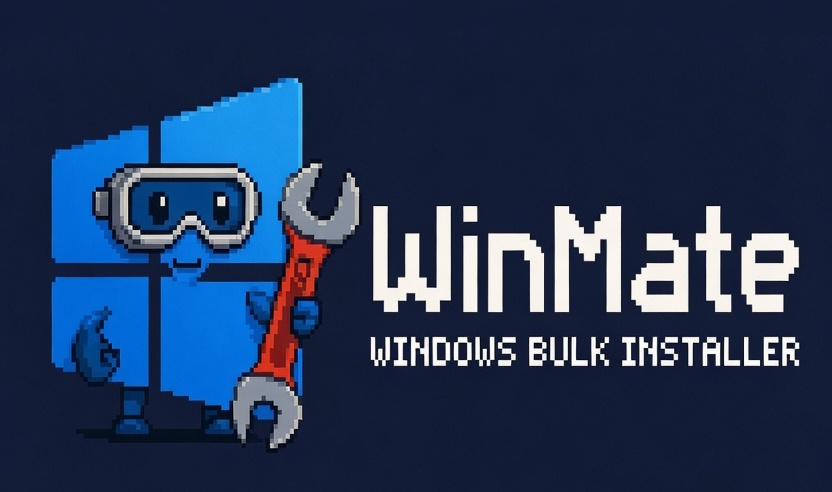

<div align="center">



**One install script for a freshly installed Windows.**

WinMate builds a single install script from a catalog of 373 checked Windows apps.<br>
Select apps, choose a package manager, read the script, run it.

[](https://github.com/baba537/WinMate/actions/workflows/ci.yml)
[](https://github.com/baba537/WinMate/actions/workflows/catalog-check.yml)
[](LICENSE)


**[winmate.baba537.workers.dev](https://winmate.baba537.workers.dev)** · [Security](SECURITY.md) · [Changelog](CHANGELOG.md) · [Roadmap](docs/ROADMAP.md)

</div>

---

## What it does

**Catalog**
- 373 apps in 25 categories, including the runtimes many programs expect: Visual C++ Redistributables, .NET,
  DirectX, XNA and Java.
- Categories are listed alphabetically; inside a category the apps follow a maintained ranking, best first.
- 16 bundles in three groups (Basics · Play & Create · Tech & Server). Each bundle has a small set of **core
  apps** that is preselected and an **extended selection** of optional additions that starts unticked.
- Profiles: the selection can be exported as JSON, shared as a link and reused by the CLI.
- Keyboard: `/` search, arrow keys, `Space` select, `A` all visible, `C` clear, `U` undo, `B` bundles,
  `P`/`1`–`3` package manager, `S` script, `Y` copy, `D` download, `?` help.

**The generated script**
- One administrator prompt for all installers. Apps whose installers refuse elevation, such as Spotify, run
  under the normal user account.
- Runtimes are installed first, failed apps are retried once, and a summary lists the result.
- Optional version pinning to the versions recorded by the weekly catalog check (winget, Chocolatey).
- After an install run it writes an undo script that removes only the apps that run installed.
- Runs as `WinMate-Install.cmd`, as a `.ps1`, pasted into PowerShell, or as a winget import file.
- Logs and run records live in `%LOCALAPPDATA%\WinMate`.

**Command line: `winmate.ps1`**

```powershell
.\winmate.ps1 -List -Search browser                 # browse the catalog
.\winmate.ps1 -Apps firefox,vlc,7zip                # install three apps
.\winmate.ps1 -Bundle gaming -PinVersions           # install a bundle
.\winmate.ps1 -ProfilePath .\winmate-profile.json   # install a selection from the website
.\winmate.ps1 -Verify .\WinMate-Install.cmd         # check a downloaded script
.\winmate.ps1 -Logs                                 # run history, logs, undo scripts
```

The catalog is embedded in the file, so nothing is downloaded from WinMate and nothing is sent anywhere.
Download it from the [latest release](https://github.com/baba537/WinMate/releases/latest), which carries a build
provenance attestation, or from the website at `/winmate.ps1`.

## Trust and transparency

A tool that installs software with administrator rights has to be verifiable.

| Question | Answer |
|---|---|
| Is the script manipulated? | Every script embeds the same engine, and its SHA-256 is published. `winmate.ps1 -Verify` checks it and prints what the script will do. |
| Where do the release files come from? | They are built by the public [release workflow](.github/workflows/release.yml) and carry a signed build provenance attestation (`gh attestation verify`). |
| Can the build be reproduced? | Yes. Dates come from the commit, [CI](.github/workflows/ci.yml) builds twice and fails on any difference, and `build-info.json` lists version, commit and hashes. |
| Are the package IDs correct? | They are checked against the official winget, Scoop and Chocolatey indexes on every catalog change and [once a week](.github/workflows/catalog-check.yml). Each app page shows manifest links and recorded versions. |
| Who verifies the installers? | winget compares installer hashes against its manifests, Chocolatey moderates and scans packages, Scoop checks manifest hashes. Details and limits are in [SECURITY.md](SECURITY.md). |
| What if an install goes wrong? | Run record, undo script, one retry and detailed logs. |
| Any data collected? | No telemetry, no cookies, no accounts. The selection stays in the browser. See the [privacy page](https://winmate.baba537.workers.dev/privacy/). |

**Limits:** scripts are not Authenticode-signed, there has been no independent security audit, and the project
has a single maintainer and was written with AI assistance. Reviews and bug reports are welcome; see
[SECURITY.md](SECURITY.md) and [CONTRIBUTING.md](CONTRIBUTING.md).

## The single administrator prompt

```
WinMate-Install.cmd (normal user)
 ├─ registers winget if needed, warns about a pending restart
 ├─ starts ONE elevated PowerShell  ──►  installs all normal apps silently
 │                                        (they inherit the rights), writes results to %TEMP%
 ├─ runs "noAdmin" apps as the normal user (for example Spotify)
 ├─ prints the summary, saves the run record and undo script
 └─ offers a restart if an installer needs one
```

If the script is already running as administrator, "noAdmin" apps are started as the signed-in user through a
one-time scheduled task. Scoop never needs administrator rights.

## Project structure

```
data/
  apps.json          app catalog, sorted by category and ranking
  categories.json    category names and intros (EN/DE)
  presets.json       bundles with group, icon, core apps and extended apps
  versions.json      versions recorded by the catalog check
src/
  ps/engine.ps1      PowerShell engine embedded into every script
  ps/cli.ps1         template of winmate.ps1
  js/app.js          script builder (no dependencies)
  css/style.css      styles (dark/light, animations can be turned off)
  icons/, img/, fonts/
build.py             static site generator -> dist/
i18n.py, pixel.py    texts (EN/DE), pixel icons and background
tools/
  validate_packages.py   checks package IDs, records verified versions
  fetch_icons.py         downloads and normalizes icons
  test_script.py         engine and CLI tests
  check_site.py          links, IDs and hashes of the built site
docs/                    roadmap, catalog policy
.github/                 CI, catalog check, releases, issue templates
```

## Local development

Requires Python 3.11 or newer; the standard library is enough.

```bash
python build.py                       # builds dist/
python tools/check_site.py
python tools/test_script.py --run     # Windows: engine and CLI tests
python -m http.server 8000 -d dist    # open http://localhost:8000
```

## Deployment

The site runs on Cloudflare (Workers static assets). Build command `python3 build.py`, output directory `dist`.
`_headers` (security and caching), `_redirects`, `sitemap.xml`, `robots.txt` and `llms.txt` are generated. Set
`SITE_URL` when the site moves to another domain. Every push to `main` deploys.

## Adding or fixing an app

1. Add an entry to `data/apps.json`, following the [catalog policy](docs/catalog-policy.md):

   ```json
   {"id": "vlc", "name": "VLC media player", "category": "media", "homepage": "https://www.videolan.org/vlc/",
    "winget": "VideoLAN.VLC", "scoop": "extras/vlc", "choco": "vlc", "icon": "flathub:org.videolan.VLC",
    "description": {"en": "Plays almost every audio and video format.", "de": "Spielt fast jedes Audio- und Videoformat ab."}}
   ```

   - `winget`: a string or a list of IDs. Microsoft Store apps use `msstore:<ProductId>`.
   - `scoop`: always `bucket/name`.
   - `noAdmin: true` for installers that refuse to run elevated; the validator reports these.
   - `icon`: `dash:<name>`, `flathub:<app-id>`, `url:<image-url>`, `site:<homepage>` or `gen:<text>`.
   - Position inside its category is the ranking, best first.
2. Run `python tools/validate_packages.py --elevation`, `python tools/fetch_icons.py <id>` (needs Pillow) and
   `python build.py`.
3. Check the icon on the page and open a pull request. More in [CONTRIBUTING.md](CONTRIBUTING.md).

## Inspiration

WinMate is inspired by [TuxMate](https://tuxmate.com/) ([abusoww/tuxmate](https://github.com/abusoww/tuxmate)),
a bulk app installer for Linux. WinMate applies the same idea to Windows with winget, Scoop and Chocolatey. No
code was copied.

## Disclaimer

WinMate was written with the help of Claude AI by Anthropic. It is not affiliated with Microsoft or with any
listed software vendor. All product names, logos and trademarks belong to their respective owners. Packages come
from the winget, Scoop and Chocolatey communities. Review a script before running it.

## License

MIT, see [LICENSE](LICENSE).
